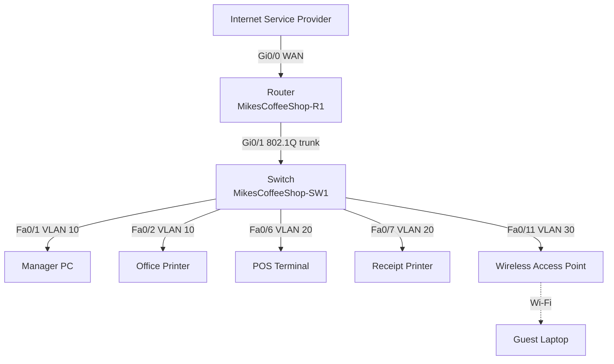

# Coffee Shop Network — Cisco Packet Tracer Lab

A secure small-business network built from scratch in Cisco Packet Tracer for a fictional coffee shop owner. The design segments an office, a point-of-sale (POS) system and public guest Wi-Fi into separate VLANs, routes between them with router-on-a-stick, hands out addresses with DHCP, and uses an ACL to keep guests away from internal business resources.

> **Scenario:** Mike is opening a coffee shop next week and has no network. He needs a secure office network, a reliable POS system for card payments, and free Wi-Fi for customers, all kept properly separated.

---

## Skills Demonstrated

- Requirements gathering and translating business needs into a network design
- VLAN design and switch port assignment (with future growth planned in)
- 802.1Q trunking with an allowed-VLAN list
- Inter-VLAN routing with router-on-a-stick (subinterfaces)
- DHCP on a Cisco router (excluded ranges, per-VLAN pools)
- Extended named ACLs for guest isolation (including the DHCP permit-ordering pitfall)
- Device hardening: secret passwords, password encryption, login banners, console protection
- Secure remote management with SSH (no Telnet) on a dedicated management VLAN
- Verification, testing and documentation habits

## Topology

Add your own Packet Tracer screenshot to `screenshots/` and your `.pkt` file to `topology/`.

## Design at a Glance

| VLAN | Name | Purpose | Subnet | Gateway |
|------|------|---------|--------|---------|
| 10 | MGMT-OFFICE | Manager PC and office printer | 192.168.10.0/24 | 192.168.10.1 |
| 20 | POS | POS terminal and receipt printer | 192.168.20.0/24 | 192.168.20.1 |
| 30 | GUEST-WIFI | Customer wireless | 192.168.30.0/24 | 192.168.30.1 |
| 99 | NETWORK-MGMT | Switch and infrastructure management | 192.168.99.0/24 | 192.168.99.1 |

The first 20 addresses of each subnet are reserved for infrastructure and static devices (gateways, printers, switch SVI).

## Results

| Test | Expected | Result |
|------|----------|--------|
| Office PC to gateway, printer, POS (inter-VLAN) | Success | Pass |
| POS terminal to gateway and receipt printer | Success | Pass |
| Guest laptop to its own gateway | Success | Pass |
| Guest laptop to Office VLAN | Blocked | Pass |
| Guest laptop to POS VLAN | Blocked | Pass |

## Known Limitations

- The ISP-facing interface has no IP address, so there is no NAT, default route or real internet access yet. This is the next lab.
- The access point is placed in the guest VLAN for lab simplicity. Production designs usually manage the AP from a separate management VLAN.

## Author

**XypherSec** — Cybersecurity analyst and web application penetration tester
GitHub: [github.com/XypherSec](https://github.com/XypherSec)

